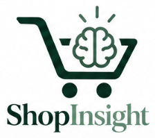

 <div align="center">
  

  # ShopInsight AI

  ### E-Commerce Purchase Intelligence & Decision-Support System

  **CMPT 310 – Artificial Intelligence | Group 13**

  **Milestone 1 – Progress & Baseline Implementation**
</div>

**Team Members:** Arshdeep Kaur Saran, Marco Loi, Roman Preet Kaur, Tanush Dhoopar

---

## About the Project

ShopInsight AI is our machine learning project focused on predicting whether an online shopping session will result in a purchase.

By analyzing browsing behaviour and session information, we aim to identify purchasing patterns and estimate the likelihood of a customer making a purchase. Our goal is to explore how AI can support better decision-making in e-commerce.

## Dataset

We use the **[Online Shoppers Purchasing Intention Dataset](https://archive.ics.uci.edu/dataset/468/online+shoppers+purchasing+intention+dataset)** from the UCI Machine Learning Repository.

| Dataset Details | Value |
|---|---|
| Original sessions | 12,330 |
| Sessions after cleaning | 12,205 |
| Input features | 17 |
| Target variable | Revenue |
| Prediction task | Binary classification |

The dataset includes browsing duration, page visits, visitor type, traffic information, and other session-related features.

## Milestone 1 — Our Progress

We have completed our initial machine learning pipeline, including:

- **Data Exploration:** Examined data quality, feature distributions, purchasing patterns, and class imbalance.
- **Preprocessing:** Removed duplicates, encoded categorical features, standardized numerical features, and created training, validation, and test sets.
- **Baseline Models:** Implemented Logistic Regression, Decision Tree, and K-Nearest Neighbors (KNN).
- **Model Evaluation:** Compared accuracy, precision, recall, F1-score, ROC-AUC, and average precision using tables and visualizations.
- **Additional Experiments:** Investigated PageValues, balanced class weights, and decision threshold tuning.
- **Prediction Demonstration:** Generated purchase predictions and estimated probabilities for sample shopping sessions.

## Model Performance

Our initial results on the validation set are:

| Model | Accuracy | F1-Score | ROC-AUC |
|---|---:|---:|---:|
| Logistic Regression | 88.86% | 0.5189 | 0.8921 |
| **Decision Tree** | **89.79%** | **0.6492** | **0.9231** |
| KNN | 88.37% | 0.5192 | 0.8067 |

The Decision Tree achieved the strongest baseline performance. With class-weight balancing and threshold tuning, its validation F1-score reached **0.6799** at a threshold of **0.65**.

Our experiments also highlighted the importance of PageValues and the challenges of predicting purchases in an imbalanced dataset.

## Project Structure

```text
ShopInsight-AI/
├── assets/        Project logo and images
├── data/          Dataset information
├── notebooks/     Colab implementation
├── results/       Evaluation results and graphs
├── reports/       Milestone reports
├── src/           Source code
└── README.md
```

## Tools & Technologies

**Python** · **Google Colab** · **NumPy** · **pandas** · **scikit-learn** · **Matplotlib** · **Seaborn** · **GitHub**

## Next Steps

For Milestone 2, we plan to expand beyond our baseline models by implementing a neural network from scratch using NumPy, including forward propagation, backpropagation, and SGD.

We also plan to explore gradient boosting, investigate PageValues further, and evaluate how well our models generalize to later shopping periods.

---

**ShopInsight AI — CMPT 310 | Group 13**
